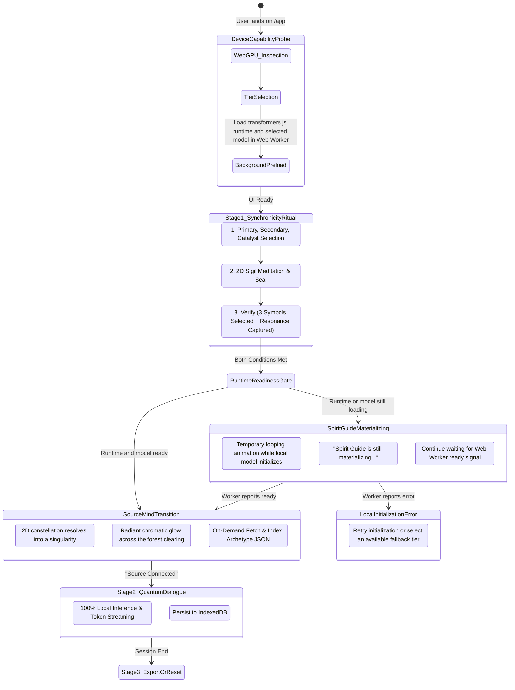

# App Page Specification & Interaction Architecture

> **Document Status**: Approved Baseline / Ready for Implementation  
> **Route**: `/app` (The Alignment Portal)  
> **Primary Objective**: Provide a zero-friction, 100% private, browser-native AI dialogue. A lightweight ritual of ordered archetype selection and a 2D Resonance Sigil capture mathematically seed a unique LLM behavior and archetypal prompt variant for personalized life/career guidance.

---

## 1. Core Philosophy & Architectural Foundations

The **Alignment Portal** (`/app`) is the core engine of **qSpirit Guide**. It transforms psychological reflection and life-direction exploration into a mathematically grounded, browser-local experience:

* **Implicit Multiverse Coordinates & Seed Generation**: Rather than manual choice trees or complex UI branch diagrams, every session maps to an exact point in the "multiverse" determined mathematically by the user's **3 ordered archetype symbols** and the captured phase of a **2D Resonance Sigil**. This generates a deterministic **32-bit LLM Sampling Seed** and an exact index into an archetypal prompt library.
* **On-Demand Archetypal Prompt Architecture**: 9 separate server-hosted JSON files (one for each archetype) contain dynamically growing catalogs of curated system prompts. Only the primary archetype JSON is fetched on-demand when a session starts; the secondary and catalyst selections contribute deterministic seed material.
* **100% In-Browser Privacy**: All inference runs locally in the user's browser via WebGPU/WASM (`@huggingface/transformers`). Zero prompts or conversation logs are sent to any cloud server.
* **Automatic Hardware Capability Routing**: The client environment is evaluated on page load to automatically choose between a 1B parameter model (for capable WebGPU devices), a 360M parameter model (for constrained WebGPU devices), and a 135M parameter model (for WASM fallback).
* **Local Storage Only**: State and conversation logs persist strictly in client-side `IndexedDB` / `localStorage`.
* **Deliberately Lightweight Presentation**: The ritual uses semantic HTML, static image assets, and CSS animations. It does not use Three.js, WebGL, canvas-based particles, custom shaders, video backgrounds, or a physics engine. GPU and network capacity remain available for local-model initialization and inference.

---

## 2. Platform Capability Detection & Automated Model Routing

The application automatically benchmarks and inspects the client platform during initial load without requiring manual user configuration.

### A. Capability Detection Matrix

```typescript
interface DeviceCapabilityReport {
  hasWebGPU: boolean;
  adapterInfo?: GPUAdapterInfo;
  maxStorageBufferSize: number; // bytes
  deviceMemoryGB: number;       // navigator.deviceMemory (approx)
  logicalCores: number;         // navigator.hardwareConcurrency
  isMobile: boolean;
  recommendedTier: '1B-WebGPU' | '360M-WebGPU' | '135M-WASM';
}
```

### B. Decision Logic & Fallback Ladder

1. **WebGPU Evaluation**:
   * Inspect `navigator.gpu`.
   * Call `navigator.gpu.requestAdapter({ powerPreference: "high-performance" })`.
   * Check `adapter.limits.maxStorageBufferBindingSize` and `adapter.limits.maxBufferSize`.
2. **Memory & Platform Thresholds**:
   * **Tier 1 (High Performance — 1B Model)**:
     * WebGPU available AND `maxStorageBufferBindingSize >= 1GB` (1,073,741,824 bytes).
     * `navigator.deviceMemory >= 4` (or desktop browser with verified discrete/integrated WebGPU limits).
    * Model target: `meta-llama/Llama-3.2-1B-Instruct` (Meta access terms apply; implementation must pin and verify a compatible ONNX/WebGPU conversion before deployment).
   * **Tier 2 (Standard / Mobile WebGPU — 360M Model)**:
     * WebGPU available, but constrained memory (`deviceMemory < 4` or mobile device).
     * Model target: `HuggingFaceTB/SmolLM2-360M-Instruct` (or a compatible ONNX/WebGPU conversion).
   * **Tier 3 (CPU / WASM Fallback — 135M Model)**:
     * WebGPU unavailable or context creation fails.
     * Model target: `HuggingFaceTB/SmolLM2-135M-Instruct` executed over ONNX Runtime Web WebAssembly with multi-threading (or a compatible ONNX conversion).

### C. Background Runtime Preload

The selected `@huggingface/transformers` runtime and the selected model must begin loading in a dedicated Web Worker immediately after capability detection and continue in the background while the user completes the archetype-selection and Resonance Sigil ritual. The preload must not block rendering, selection feedback, CSS animation, or pointer interaction.

The worker reports explicit lifecycle states to the UI: `idle`, `loading-runtime`, `loading-model`, `ready`, and `error`. The UI may show lightweight progress or a capability status indicator, but it must not expose raw model-loading logs or imply that the guide is ready before the worker reports `ready`. Model initialization, tokenizer loading, model-weight loading, and the selected execution backend are all part of the same readiness gate.

When the ritual is complete, the application checks the worker readiness state before entering dialogue. If the runtime and model are ready, the normal transition begins immediately. If they are still loading, the application enters the temporary **Spirit Guide Materializing** state described in Section 4.E and waits for the worker's `ready` message. If initialization fails, the UI must show a recoverable local error and offer retry or fallback routing where available; it must not enter the chat with an uninitialized pipeline.

---

## 3. End-to-End User Journey & State Machine



---

## 4. UI / UX Detailed Specifications: The Synchronicity Setup Ritual

The welcoming ritual on `/app` prepares the user mentally and sets the mathematical parameters for the local LLM.

### A. First-Time User Onboarding & Ordered Selection Guidance

A warm, atmospheric instruction header teaches the three distinct archetype roles. It must make clear that the first symbol does not complete the choice: the user must select a **Primary**, **Secondary**, and **Catalyst** in that exact order.

```
┌─────────────────────────────────────────────────────────────────────────────┐
│                       ✦ THE SYNCHRONICITY RITUAL ✦                          │
│                                                                             │
│  Phase 1: Three-Part Constellation      Phase 2: Meditative Stillness        │
│  "Choose a Primary, then a Secondary,   "Breathe, center your thoughts, and │
│   then a Catalyst. Trust your first     seal the moving resonance when ready."│
│   instinct at each step."                                                    │
│                                                                             │
│  [ Step 1: Choose Primary ] ────────── [ Step 2: Resonance Awaiting Seal ]  │
│                                                                             │
│         * The Spirit Guide awakens once both actions are sealed *           │
└─────────────────────────────────────────────────────────────────────────────┘
```

* **Persistent role legend**: Display `Primary - Secondary - Catalyst` above the symbol field at all times. The active role has the strongest contrast and an explicit instruction, rather than a generic `1 / 3` counter.
* **Primary selection**: The first selection expands into a labelled Primary slot. Immediately change the stage prompt to: "Choose a second symbol that supports or challenges it." Progress reads `Primary sealed - Choose Secondary (1 of 3)`.
* **Secondary selection**: The second selection fills its labelled slot and a fine CSS light-thread connects it to the Primary. Change the stage prompt to: "Choose one final symbol: the catalyst that shifts the pattern." Progress reads `Primary + Secondary sealed - Choose Catalyst (2 of 3)`.
* **Catalyst selection**: The third selection completes a three-point constellation. All three role labels remain visible, the constellation gains a restrained glow, and the central Resonance Sigil becomes available. Progress reads `Constellation complete - Seal the resonance`.
* **Clear activation gate**: An explicit status meter highlights that both conditions (three ordered selections and a sealed resonance) must be completed to awaken the guide.

---

### B. Forest Convergence & 2D Resonance Sigil (Interactive Seed Generator)

The ritual occurs over an atmospheric static forest-clearing image. CSS provides a small number of low-cost, decorative motion layers: drifting mist, distant light motes, moving moonbeams, and a slow ambient glow. All movement must be disabled or substantially reduced for `prefers-reduced-motion`.

At the center is a responsive **Resonance Sigil** built with HTML and CSS: concentric rings, three constellation anchors, and one smoothly orbiting or oscillating phase marker. The sigil is the neutral destination for every archetype; the forest setting must not imply that Forest is the default or preferred archetype.

#### 1. Resonance Interaction
* After Catalyst selection, the phase marker begins its CSS-led motion around or across the sigil. The UI enables a clear command: **Seal the resonance**.
* The user may click the sigil or activate that control by keyboard. Pointer proximity may modestly increase glow or ring contrast but must not affect the captured result.
* On activation, application logic snapshots the motion at the exact event timestamp. It derives normalized phase, estimated velocity, and elapsed time from the same deterministic animation model; it does not read pixels, use a canvas, or require a physics simulation.
* A brief CSS shockwave radiates from the sigil. The captured result appears accessibly as text, for example: `Phase: +0.412 | Velocity: 0.884 | Resonance sealed`.

#### 2. Capture Model

The visual may use an oscillation equivalent to:

$$p(t) = \sin\left(\frac{2\pi t}{T}\right)$$

where $p(t)$ is normalized phase, $T$ is a documented, fixed cycle duration, and velocity is the normalized derivative at the captured timestamp. The implementation must calculate the capture from `performance.now()` and the fixed motion constants, so a CSS frame rate change cannot corrupt telemetry.

---

### C. The 9 Archetype Symbols (Rapid Subconscious Selection)

A balanced 3x3 symbol field frames the Forest Convergence stage. The user picks three in order: Primary, Secondary, then Catalyst. Each card has an accessible label and keyboard-focus state; selection order is visible in the three labelled slots above the grid.

1. 🌲 **The Ancient Forest** (`forest.json`) *(Grounding, organic patience, ecological perspective)*
2. ⚓ **The Iron Anchor** (`anchor.json`) *(Emotional stability, boundaries, unwavering resilience)*
3. 💎 **The Prismatic Crystal** (`crystal.json`) *(Clarity, multifaceted truth, intellectual refraction)*
4. ⏳ **The Obsidian Hourglass** (`hourglass.json`) *(Urgency calibration, temporal focus, cycles)*
5. 🧭 **The Star Compass** (`compass.json`) *(Directionality, purpose alignment, north star)*
6. 🌊 **The River Tide** (`tide.json`) *(Adaptability, release of resistance, flow state)*
7. 🔥 **The Hearth Fire** (`fire.json`) *(Creative passion, bold transformation, spark)*
8. 🗝️ **The Hidden Key** (`key.json`) *(Unlocking repressed desire, curiosity, breakthrough)*
9. 🪞 **The Silver Mirror** (`mirror.json`) *(Shadow reflection, radical self-honesty, acceptance)*

---

### D. The Transition Sequence: "Harmonic Convergence to Source Mind"

Once both actions are sealed (three ordered symbols and resonance capture) and the worker reports `ready`, an immersive 1.8-second CSS transition begins:

```
[Resonance Seal] ──► [Constellation Convergence] ──► [Canopy Bloom] ──► [Quantum Dialogue Interface]
```

1. **Constellation Convergence (0.0s - 0.5s)**:
  * The three selected symbol cards glow and their CSS light-threads draw inward to the Resonance Sigil.
  * The sigil rings contract into a single, intensely glowing point.
2. **Canopy Bloom (0.5s - 1.3s)**:
  * The point resolves into a restrained chromatic light wash across the forest clearing (evergreen, muted teal, warm amber, and rose-gold accents).
  * The transition is silent. No sound is required, started automatically, or used as a state signal.
   * Text reveal in center: *"Synchronizing with Source Mind..."*
3. **Interface Emergence (1.3s – 1.8s)**:
   * The color bloom softens into the ambient dark glassmorphic chat interface.
   * The top HUD displays the freshly computed Multiverse Signature (e.g. `Ψ-831.04 • Forest / Key / Mirror #02`).
   * The local LLM emits its initial welcoming reflection.

### E. Spirit Guide Materialization While Preloading

If the user completes the archetypes and resonance capture before `@huggingface/transformers` and the selected model are ready, hold the user in a temporary transition state instead of showing an empty or partially initialized chat. The sigil/bloom treatment may continue as a seamless, low-motion CSS loop, with a calm status message such as *"Spirit Guide is still materializing..."* and an optional local progress indicator for runtime and model readiness.

The loop must be interruptible by the worker's `ready` or `error` message. On `ready`, finish the current visual cycle or crossfade directly into the normal Source Mind transition, resolve the primary archetype prompt, and open dialogue. On `error`, stop the loop and present a recoverable initialization error with retry and any supported fallback option. The user must retain the selected symbols and resonance capture throughout this wait, and the app must not re-run the ritual unless the user chooses to reset.

---

## 5. Mathematical Multiverse Coordinate, Seed & Prompt Engine

### A. Multiverse Vector & Randomizer Seed Calculation

The system computes a deterministic entropy vector and a 32-bit unsigned integer randomizer seed from the ritual telemetry:

$$\mathbf{M}_{\text{coord}} = f(\text{Symbols}_{\text{primary, secondary, catalyst}}, p, v, \Delta t)$$

```typescript
export interface MultiverseVector {
  // Qualitative triad in selection order: primary, secondary, catalyst
  symbols: [string, string, string];
  
  // 2D Resonance Sigil capture telemetry
  phase: number;             // p ∈ [-1.0, 1.0]
  velocity: number;          // v ∈ [-1.0, 1.0]
  elapsedMs: number;         // Δt in ms
  
  // Computed randomizer & sampling outputs
  seed32: number;           // uint32 ∈ [0, 4294967295]
  temperature: number;      // e.g. 0.65 - 0.85
  topP: number;             // e.g. 0.85 - 0.95
  
  // Archetype indexing
  selectedPromptIndex: number; // Seeded index into the primary archetype's JSON catalog
  multiverseSignature: string; // e.g. "Ψ-831.04-FOREST-KEY-MIRROR#02"
}
```

#### Deterministic 32-Bit Seed Generation
```typescript
function computeMultiverseSeed(symbols: string[], phase: number, velocity: number, elapsedMs: number): number {
  const payload = `${symbols.join(':')}|${phase.toFixed(6)}|${velocity.toFixed(6)}|${elapsedMs}`;
  return hashToUint32(payload);
}
```
This `seed32` is directly passed to the local LLM generation pipeline (e.g. `transformers.js` sampler or PRNG) to fix the random sampling sequence to that exact multiverse coordinate.

---

### B. On-Demand Archetypal System Prompt Architecture

System prompts are organized into 9 modular JSON files located under `/prompts/archetypes/`:

```
public/prompts/archetypes/
├── forest.json
├── anchor.json
├── crystal.json
├── hourglass.json
├── compass.json
├── tide.json
├── fire.json
├── key.json
└── mirror.json
```

#### JSON File Schema (`archetype-schema.json`)
```json
{
  "archetype": "forest",
  "name": "The Ancient Forest",
  "coreEssence": "Root grounding, natural pace, patience, and ecological perspective",
  "prompts": [
    {
      "id": "forest-01",
      "harmonicTone": "contemplative-grounding",
      "quadrant": "inward-stillness",
      "systemPrompt": "You are qSpirit Guide operating through the archetype of The Ancient Forest. Your core presence is deeply grounded, unhurried, and reassuring. The seeker is exploring life and career crossroads. Remind them that growth occurs in deep subterranean roots before visible branches form..."
    },
    {
      "id": "forest-02",
      "harmonicTone": "strategic-ecological",
      "quadrant": "forward-growth",
      "systemPrompt": "You are qSpirit Guide under the Ancient Forest canopy. Help the seeker view their career ecosystem holistically—identifying which current commitments drain their soil and where natural sunlight calls them next..."
    }
  ]
}
```

---

### C. Archetype Roles and Prompt Selection Algorithm

The three archetype selections have fixed roles based on selection order:

1. `selectedSymbols[0]` is the **primary archetype**. Its JSON file is the only archetype catalog fetched for the session.
2. `selectedSymbols[1]` is the **secondary archetype**. Its stable archetype identifier contributes to prompt selection seed material.
3. `selectedSymbols[2]` is the **catalyst archetype**. Its stable archetype identifier also contributes to prompt selection seed material.

The secondary and catalyst selections do not independently select prompt files or prompt indexes. They influence which one of the primary catalog's prompts is chosen.

1. **Zero Eager Overhead**: No prompt files are loaded on page load.
2. **On-Demand Fetch**: Upon completing the ritual, the app fetches the primary archetype's JSON file:
  ```typescript
  const primaryArchetype = selectedSymbols[0];
  const response = await fetch(`/prompts/archetypes/${primaryArchetype}.json`);
  if (!response.ok) throw new Error('Primary archetype catalog unavailable');
  const data: ArchetypeCatalog = await response.json();
  ```
3. **Seeded Prompt Selection**:
  Let $N = \text{data.prompts.length}$. If $N = 0$, fail closed and show that the primary catalog is unavailable. Otherwise, derive a deterministic selection seed from the secondary and catalyst identifiers, while retaining the resonance/session seed as additional session entropy:
  ```typescript
  const selectionPayload = `${selectedSymbols[1]}:${selectedSymbols[2]}|${seed32}`;
  const selectionSeed = hashToUint32(selectionPayload);
  const rng = createSeededPrng(selectionSeed);
  const selectedPromptIndex = rng.nextInt(data.prompts.length);
  const selectedPrompt = data.prompts[selectedPromptIndex];
  ```
  `createSeededPrng` must be a documented, deterministic 32-bit PRNG, and `nextInt(N)` must produce a uniform integer in `[0, N - 1]`. The same ordered selections, resonance telemetry, model session seed, and catalog version must resolve to the same prompt index.
4. **Prompt Assembly**:
   The selected primary system prompt is sent to the Web Worker with the ordered archetype identifiers and multiverse signature as structured metadata. Do not claim to append secondary or catalyst traits unless those traits are available locally or included in the primary catalog. The raw system prompt is never exposed in the user-facing UI.

---

## 6. Stage 2: The Quantum Dialogue (Chat Interface)

### A. UI Layout & Elements
* **Top Bar / HUD**:
  * **Multiverse Signature Pill**: Displays the session's coordinate (e.g. `Ψ-831.04 • Forest / Key / Mirror #02`).
  * **Off-Grid Trust Indicator**: 🟢 `100% Off-Grid • WebGPU Active` (with hover metrics: generation speed in `tokens/s`, local memory consumption).
  * **Reset / New Journey Button**: Clears the session and returns to the Synchronicity Ritual.
* **Message Feed**:
  * Glassmorphic response cards with clear contrast and elegant typography.
  * Live token streaming with smooth easing and typing pulse.
* **Input Area**:
  * Ergonomic auto-expanding text input.
  * Quick-starter suggestions on first turn (*"I feel stuck between staying in my safe job and switching to design"*, *"I'm turning 35 and feel like I'm running out of time"*).

### B. Model Context Budget and Conversation Compaction

The selected model's context window must be treated as a runtime capability, not as an unlimited conversation buffer. Each model manifest must define or expose:

```typescript
interface ModelContextProfile {
  modelId: string;
  contextWindowTokens: number;
  reservedOutputTokens: number;
  minimumPromptTokens: number;
}
```

Before every generation, tokenize the system prompt, local conversation summary, recent messages, and current user message. Keep the total input below `contextWindowTokens - reservedOutputTokens`. The UI should show a clear loading or recovery state if tokenization or generation fails because the budget cannot be satisfied.

When the history exceeds the available budget, compact it locally in this order:

1. Preserve the system prompt, archetype metadata, multiverse signature, and the current user message.
2. Replace the oldest contiguous block of user and assistant messages with a concise model-generated summary containing decisions, open questions, user-stated preferences, and unresolved threads.
3. Retain the most recent messages verbatim, then retry tokenization before generation.
4. Persist the summary and the complete uncompressed transcript separately. Compaction must never delete transcript data or send it to a remote service.

The compaction prompt and summary format should be versioned, and the implementation should test prompt assembly at the context limit, after repeated compaction, and across all three model tiers. The full transcript remains available for Markdown export even when the active model context contains only a summary and recent turns.

---

## 7. Data Persistence & Export (Stage 3)

* **IndexedDB Store (`qspirit_vault`)**:
  * Schema:
    ```typescript
    interface VaultSession {
      id: string;                      // UUID
      timestamp: number;
      signature: string;               // Multiverse coordinate
      seed32: number;                  // Sampling seed
      symbols: [string, string, string];
      promptId: string;                // e.g. "forest-02"
      resonanceCapture: { phase: number; velocity: number; elapsedMs: number };
      contextSummary?: string;         // Local rolling summary used for generation
      compactionVersion?: string;      // Version of the summary prompt and format
      messages: Array<{ role: 'user' | 'assistant'; content: string; timestamp: number }>;
    }
    ```
* **Local Control**:
  * **Export to Markdown**: Generates a clean reflection journal file containing the Multiverse signature, active archetypes, seed, and full dialogue transcript.
  * **Zero Timeline Button**: Permanently deletes all IndexedDB records and clears session memory.

---

## 8. Technical Architecture & Worker Pipeline

```
[UI Layer: React 19 / Astro / semantic HTML + CSS]
      │
      ├── 1. Initial Load: Probes WebGPU / System Memory
      ├── 1a. In Parallel With Ritual: Loads `@huggingface/transformers` and the selected model in a Web Worker
      ├── 2. Ritual Phase:
      │       ├── Collects Primary, Secondary, and Catalyst symbols
      │       └── 2D Resonance Sigil (captures phase, velocity, elapsed time)
      ├── 3. "Canopy Convergence" CSS Transition Animation
      ├── 4. Computes Multiverse Vector & Seed32
      ├── 5. On-Demand Fetch: GET /prompts/archetypes/{symbol}.json
      ├── 6. Indexes Prompt[k] via Multiverse Vector
      │
      ▼ PostMessage({ type: 'init' | 'generate', payload: { prompt, seed32, temp, topP } })
[Dedicated Web Worker: /workers/llmWorker.ts]
      │
      ├── Loads `@huggingface/transformers`
      ├── Sets deterministic PRNG / sampler seed: `seed32`
      ├── Runs text generation with chosen local model tier
      ├── Streams tokens via callback
      │
      ▼ Token stream back to UI
[IndexedDB Persistence Layer]
```

---

## 9. Explicitly Descoped Items (Future Phases)

* **Explicit Distress & Crisis Safety Guardrails**: Complex algorithmic detection of acute psychological distress / automated crisis intervention routing is **descoped** from this initial milestone and reserved for a dedicated future release.
* **Visual Multiverse Branch Trees / Graph UI**: Forking visualizations are **descoped**; all multiverse branching is purely implicit and governed mathematically by the ritual seed, resonance capture, and prompt selection.
* **Cloud Sync / Remote User Accounts**: Server-side user accounts and cross-device cloud synchronization are intentionally excluded to uphold the 100% private, local-first promise.
* **3D Rendering and Heavy Decoration**: Three.js, WebGL, canvas particle systems, custom shaders, physics engines, video backgrounds, and automatic ambient audio are intentionally excluded from this page. Optional sound is a future enhancement only and must be user initiated, off by default, and unnecessary for understanding or completing the ritual.

---

## 10. Visual Asset Production Guide

### A. Asset Inventory and Performance Budget

The ritual should rely on a compact, purposeful image set. CSS supplies mist, glow, light trails, sigil rings, and transitions; generated imagery supplies only the forest environment and archetype artwork.

| Asset | Quantity | Target format and dimensions | Purpose |
| --- | ---: | --- | --- |
| Forest clearing background, desktop | 1 | WebP or AVIF, 2560 x 1440 (16:9) | Full-bleed ritual atmosphere with a clear central focal area |
| Forest clearing background, mobile | 1 | WebP or AVIF, 1440 x 1920 (3:4) | Art-directed portrait crop; omit only if the desktop image crops cleanly |
| Archetype illustrations | 9 | Transparent WebP or PNG, 1024 x 1024 source, delivered at 256-512 px | Responsive symbol cards and completed constellation slots |
| Optional grain texture | 1 | Small seamless WebP, 256 x 256 or less | Extremely subtle overlay; do not use if it reduces text contrast |

Keep the initial total image transfer budget below approximately 1.5 MB on a typical WebP/AVIF delivery. Load the desktop or mobile background responsively with `picture` or `image-set`; lazy-load no ritual-critical imagery. Deliver two or three responsive widths for the background and use cache-friendly immutable filenames. Do not use an animated image, video, Lottie file, or SVG filter effect as a replacement for CSS motion.

### B. Shared Art Direction

Create the forest background first and treat the approved result as the visual source of truth. Each archetype illustration must share its moonlight direction, material language, contrast range, and restrained palette: deep evergreen, muted teal, warm amber, and small rose-gold accents. The style should be contemplative rather than theatrical, with no text, runes, watermarks, frames, or UI-shaped backing plates.

Use the same model, style preset, seed strategy, reference image, and prompt template across the nine emblems. Record the generator, model/version, seed, prompt, negative prompt, and any reference-image strength alongside every accepted source asset so later variants are reproducible.

### C. FLUX.1 Prompt Pack

Use FLUX.1 with the final forest image as a composition/style reference when the host supports image prompting. Generate at high resolution, then curate and resize the selected result. Do not rely on generated lettering: all user-facing labels belong in HTML.

**Forest clearing, desktop**

```text
Wide cinematic enchanted forest clearing at blue hour, ancient cedar and moss,
a quiet circular clearing centered slightly below the horizon, soft shafts of
moonlight through mist, restrained bioluminescent fireflies, deep evergreen,
muted teal, warm amber, and faint rose-gold accents. Dreamlike but grounded,
editorial fantasy illustration, detailed natural textures, calm contemplative
mood, no people, no animals, no buildings, no text, no symbols, no frame.
Leave uncluttered negative space in the central clearing for an interface.
16:9 composition.
```

**Forest clearing, mobile**

```text
Portrait cinematic enchanted forest clearing at blue hour, ancient cedar and
moss framing a quiet central path and circular clearing in the middle third,
soft shafts of moonlight through mist, restrained bioluminescent fireflies,
deep evergreen, muted teal, warm amber, and faint rose-gold accents. Match the
approved desktop forest reference exactly in mood, lighting, and materials.
No people, no animals, no buildings, no text, no symbols, no frame. Preserve
clean central negative space for an interface. 3:4 composition.
```

**Archetype emblem template**

```text
Create one isolated mystical archetype emblem: [ARCHETYPE OBJECT].
Hand-crafted luminous botanical-alchemical illustration matching the supplied
approved enchanted forest clearing reference: deep evergreen, muted teal, warm
amber, and restrained rose-gold highlights; soft moonlight from upper left;
subtle aged-metal and natural-material texture; elegant, symbolic, readable at
96 pixels. Centered front-facing composition, generous transparent margins,
no lettering, no runes, no border, no pedestal, no scenery, no human figures.
Transparent background. Square composition.
```

Use these object phrases without changing the rest of the emblem prompt: `an ancient twisted oak branch with three glowing leaves` (Forest); `a weathered iron anchor wrapped in a single root` (Anchor); `a faceted prismatic crystal` (Crystal); `an obsidian hourglass with a single amber grain suspended` (Hourglass); `a brass star compass with a north-pointing needle` (Compass); `a curling river wave with a small crescent moon reflection` (Tide); `a contained hearth flame inside a dark iron brazier` (Fire); `an antique hidden key with a root-like bow` (Key); and `a polished silver hand mirror reflecting a subtle moonbeam` (Mirror).

### D. NightCafe Workflow Notes

NightCafe can be used as the generation host when it provides FLUX.1 and supports a reference image. Create the desktop background first, select one approved result, and upload that image as the reference for the mobile crop and every emblem. Use the highest available quality only for candidate generation; export the selected source and perform web optimization separately.

For each run, keep the model and style settings fixed. If seed locking is available, use one documented seed for initial exploration, then preserve the seed and alter only the subject phrase for the nine emblems. Use a low-to-moderate reference influence: enough to preserve palette and lighting, but not enough to copy the forest composition into an isolated symbol. Request square output for emblems and use NightCafe's background-removal option only when its edge quality is clean; otherwise remove backgrounds in a dedicated editor and inspect at 96 px, 160 px, and 256 px.

Avoid platform-specific preset styles that introduce typography, ornate borders, excessive purple, or busy backgrounds. Before accepting any asset, check that it is legible at its smallest rendered size, its focal object is not cropped, its edges work on a dark forest background, and it contains no accidental words or signatures. Maintain source files outside `public/`; commit only optimized, licensed web derivatives and a small provenance manifest with the original prompts and generation settings.


# MUSE prompt attempted

Main style is "Infinite mathematical psychedelic fractal art” also known as “Visionary art style”. "Neon bioluminescent glow, iridescent sheen” would also be important. Forest clearing image should be largest, serving as a general background for positioning smaller symbol images as described. Avoid any text in imagery. 

**Forest clearing, desktop**

```text
Wide cinematic enchanted forest clearing at blue hour, ancient cedar and moss,
a quiet circular clearing centered slightly below the horizon, soft shafts of
moonlight through mist, restrained bioluminescent fireflies, deep evergreen,
muted teal, warm amber, and faint rose-gold accents. Dreamlike but grounded,
editorial fantasy illustration, detailed natural textures, calm contemplative
mood, no people, no animals, no buildings, no text, no symbols, no frame.
Leave uncluttered negative space in the central clearing for an interface.
16:9 composition.
```

**Forest clearing, mobile**

```text
Portrait cinematic enchanted forest clearing at blue hour, ancient cedar and
moss framing a quiet central path and circular clearing in the middle third,
soft shafts of moonlight through mist, restrained bioluminescent fireflies,
deep evergreen, muted teal, warm amber, and faint rose-gold accents. Match the
approved desktop forest reference exactly in mood, lighting, and materials.
No people, no animals, no buildings, no text, no symbols, no frame. Preserve
clean central negative space for an interface. 3:4 composition.
```

**Archetype emblem template**

```text
Create one isolated mystical archetype emblem: [ARCHETYPE OBJECT].
Hand-crafted luminous botanical-alchemical illustration matching the supplied
approved enchanted forest clearing reference: deep evergreen, muted teal, warm
amber, and restrained rose-gold highlights; soft moonlight from upper left;
subtle aged-metal and natural-material texture; elegant, symbolic, readable at
96 pixels. Centered front-facing composition, generous transparent margins,
no lettering, no runes, no border, no pedestal, no scenery, no human figures.
Transparent background. Square composition.
```

Use these object phrases without changing the rest of the emblem prompt: `an ancient twisted oak branch with three glowing leaves` (Forest); `a weathered iron anchor wrapped in a single root` (Anchor); `a faceted prismatic crystal` (Crystal); `an obsidian hourglass with a single amber grain suspended` (Hourglass); `a brass star compass with a north-pointing needle` (Compass); `a curling river wave with a small crescent moon reflection` (Tide); `a contained hearth flame inside a dark iron brazier` (Fire); `an antique hidden key with a root-like bow` (Key); and `a polished silver hand mirror reflecting a subtle moonbeam` (Mirror).
